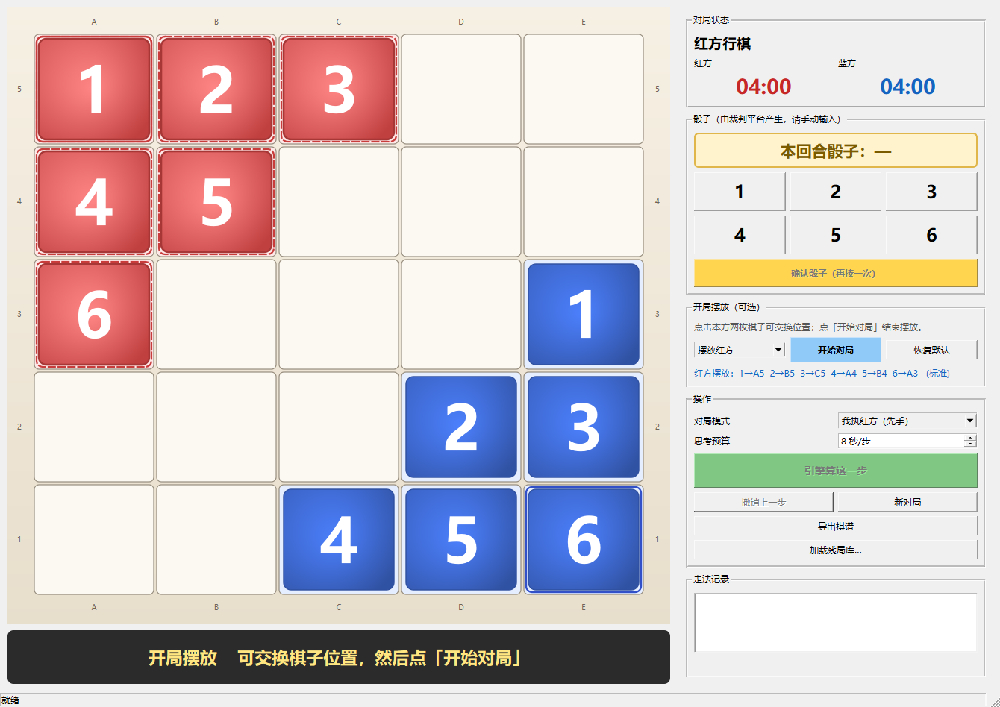

# 爱恩斯坦棋 · 对局控制台

爱恩斯坦棋（EinStein würfelt nicht!，EWN）的**对局控制台**，为「人工转述对弈」的比赛形式设计。



---

## 下载

到 [Releases](../../releases) 页面下载最新的 **EwnGui.zip**，解压后双击 `EwnGui.exe` 即可运行。

**不需要安装 Qt、不需要任何运行库、不需要联网。**

### 系统要求

- Windows 10 / Windows 11（64 位）
- 不支持 Windows 7（Qt 6 的限制）

---

## 这个程序解决什么问题

比赛时的真实流程是：

```
我算棋 → 我把走法念给对方 → 对方录入他的电脑 → 他算棋 → 他做给我看 → 我录入我的电脑
```

两个人面对面，各操作各的电脑。**最容易出错的地方不是算棋，是转录。**

所以这个程序的重心是**把手输错误的概率降到零**：

| 设计 | 原因 |
|---|---|
| 骰子必须手动输入 + 二次确认 | 骰子由裁判平台的外部程序产生，程序不能自己摇。输错一个数字，引擎会算出一个"合法但完全错误"的走法，而且不报错 |
| 走子后大字显示 | 对方要照着录入，口头复述最容易在"棋子号"和"坐标"两处出错 |
| 两步点击走子 | 比拖拽快，也更不容易点错 |
| 非法走法当场拦截 | 对方录入错误能立刻发现，而不是下错几步后才发现 |
| 双计时器独立 4 分钟 | 规则是每方 4 分钟包干，超时判负 |

---

## 功能

- **开局摆放**：双方各 6 枚棋子在出发区可任意排列（6! = 720 种）
- **骰子三段式输入**：点数字 → 确认 → 才生效
- **缺号规则**：唯一最近，仅等距时二选一
- **引擎建议**：显示推荐走法和胜率估计，但**不自动走子**
- **撤销**：录错可回退
- **棋谱导出**：WTN 标准格式，GB2312 编码
- **可选残局库**：加载后双方只剩 1/2/3 号子时直接查精确胜率

---

## 规则

- 棋盘 5×5，红蓝各 6 枚棋子（标号 1–6）
- 开局在己方出发区任意摆放
- 双方轮流掷骰，走动对应编号的棋子
- 缺号时走「最接近」的存活的棋子
- 红方走右/下/右下，蓝方走左/上/左上
- 吃子含本方棋子（自吃是合法战术）
- 到达对方角点，或吃光对方全部棋子，即获胜
- **无和棋**

---

## 使用

详细说明见压缩包里的 `使用说明.txt`。

基本流程：

1. 启动程序
2. 开局摆放（可跳过，用默认布局）
3. 点「开始对局」
4. 每回合：
   - 裁判给出骰子值
   - 点对应数字按钮（1–6）
   - 点「确认骰子」
   - 点棋子 → 点目标格
5. 结束时点「导出棋谱」

---

## 已知限制

- 界面固定红方视角（不能翻转）
- 引擎在 UI 线程同步计算（思考时界面会短暂无响应）
- 无自动存档，建议每局结束立刻导出棋谱

---

## 致谢

搜索结构参考了开源项目 [icarried/Aiensitan_Launcher](https://github.com/icarried/Aiensitan_Launcher)，
评估函数基于 Zweistein 的距离分布方法。
界面、规则引擎、时间管理和棋谱导出为独立实现。

---

## 许可

仅用于交流学习。